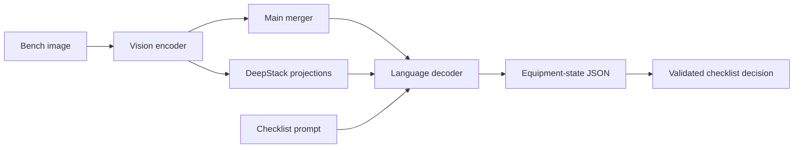

# Lab-Bench Equipment Inspection with Qwen3-VL

Computer Vision Coursework 2 · Technical report

## Abstract

This system checks whether a laboratory bench contains the equipment requested in a checklist. It uses Qwen3-VL-2B-Instruct to infer the state of each equipment category from a single overhead image. A deterministic rule then converts the states into a checklist decision. We study low-rank adaptation with paired supervision and box-guided image edits, and evaluate two deployment optimizations: language-weight quantization and input pixel budgets. Measurements on the NVIDIA L40 server use 50 photographs from nine bench layouts. M produced 2/31 false-complete decisions in the out-of-fold evaluation, compared with 7/31 for B0. Unknown recall remained low at 1/18 for M. On Jetson Orin Nano 8GB, the base-weight deployment stack built and ran: Q4_K_M and Q8_0 fitted in 8 GB, while F16 was terminated by the out-of-memory killer. Board evaluation of the final adapter, the real photographs and the camera remains pending.

## 1. System design

A user selects required equipment and supplies a saved photograph or requests a frame from the camera interface. The supported categories are screwdriver, pliers, a standalone coiled cable bundle, multimeter, and hammer. Multimeter probes belong to the multimeter, and the system scores the presence of the meter rather than reading its display.

A single vision-language model (VLM) accepts the image and the requested checklist through the same interface. This provides a direct path from a Chinese question to present, absent and unknown states, including cases where a decision depends on occlusion. A detector with a separate decision layer is a viable alternative for a fixed set of categories. This project evaluates the VLM pipeline against its own pretrained baseline.

The model returns a JSON object with one state per category. `present` indicates visible evidence of the object within the inspection area. `absent` requires sufficient visibility to confirm that the object is missing. `unknown` covers occlusion, framing and ambiguity. The application checks the JSON and derives the missing and uncertain items. A missing required item makes the decision `incomplete`. Otherwise, any uncertain required item makes the decision `unknown`. When all required items are present, the decision is `complete`.

Figure 1. The system combines visual features and a checklist prompt, then validates and interprets the predicted states.

## 2. Model principles

Qwen3-VL-2B-Instruct combines a vision transformer with a decoder-only language model. The pinned model configuration uses 16×16 spatial patches, 24 visual transformer blocks and a 2×2 spatial merger. The merger projects groups of visual features into the language model's 2,048-dimensional embedding space. The language decoder has 28 layers and uses grouped-query attention. The exact model revision is `89644892e4d85e24eaac8bacfd4f463576704203`. [Qwen3-VL technical report](https://arxiv.org/abs/2511.21631) · [Qwen3-VL-2B-Instruct model card](https://huggingface.co/Qwen/Qwen3-VL-2B-Instruct)

The chat template places image tokens in the same input sequence as the text. The main visual projection supplies their input embeddings. DeepStack projects features from intermediate visual blocks indexed 5, 11 and 17 and adds them at the image-token positions in early language layers. Interleaved multimodal rotary position embeddings represent the spatial and temporal positions of visual tokens. During inference we use greedy generation with a limit of 128 new tokens. [Qwen3-VL technical report](https://arxiv.org/abs/2511.21631) · [DeepStack paper](https://arxiv.org/abs/2406.04334)

## 3. Domain adaptation

Low-rank adaptation (LoRA) trains an update of the form $W'=W+(\alpha/r)BA$ while keeping the base weight $W$ fixed. Our adapter uses rank 16, scaling parameter 32 and dropout 0.05 on the language decoder's attention and MLP projections. The vision encoder and visual mergers remain frozen. Supervised cross-entropy is computed on assistant-response tokens. Input prompt and image tokens are excluded from the loss. [LoRA paper](https://arxiv.org/abs/2106.09685)

The full method M combines four supervision choices. A paired presence task asks the same question about the same category in two views with different ground truth. Hard-negative examples receive a sampling weight of 3 to emphasize the cable–multimeter confusion. State balancing increases exposure to rare category–state combinations. Explicit `unknown` examples teach the model to express uncertainty when the image does not resolve a state.

Box-guided edits create training pairs from real frames. One frame receives an edit in an equipment-free region and retains the source labels. The other receives a comparable edit over one item and changes that item's state to `absent` for removal or `unknown` for occlusion. The matched editing procedure helps reduce reliance on the presence of an edit as a cue. Source layout IDs travel with both images throughout the splits.

| Method | Training data | Change relative to M |
| --- | --- | --- |
| B0 | Pretrained checkpoint | No task-specific training |
| B1 | Real photographs | Plain checklist LoRA with uniform sampling |
| M | Real photographs and box-guided edits | Complete method |
| A1 | Real photographs and box-guided edits | Remove paired presence supervision |
| A2 | Real photographs and box-guided edits | Set hard-negative weight to 1 |
| A3 | Real photographs and box-guided edits | Exclude samples with `unknown` labels |
| A4 | Real photographs | Retain M's mixing policy with real data only |

## 4. Dataset card

Version `real_v1` contains 50 real photographs at 1920×1080. They were collected in one session with nine bench layouts using a fixed overhead view and auto-exposure. Each image has two checklist prompts, producing 100 checklist examples. All 50 real images have reviewed item-state annotations and equipment boxes. Eight real pair groups contain views that differ in exactly one target category. Six photographs contain at least one unknown state. The real evaluation contains 10 occlusion checklist examples and six with a visible hand that does not occlude an item.

Version `aug/v1` contains 50 removal pairs and 50 occlusion pairs, for 200 edited images and 400 checklists. The 33 true edits that remove a multimeter while retaining a standalone cable are tagged as hard negatives. The data manifest and split manifests record the inputs and hashes. Synthetic edits preserve the source scene group and are used in training folds only.

| Fold | Held-out layouts | Real training examples | Mixed training examples | Real test photos | Real test examples |
| --- | --- | ---: | ---: | ---: | ---: |
| 1 | l009 | 50 | 250 | 25 | 50 |
| 2 | l008 | 66 | 330 | 17 | 34 |
| 3 | l001–l007 | 84 | 420 | 8 | 16 |

Within each fold, the training and test sets have disjoint layout groups. Each real example appears once in the test folds. Both prompts for an image and every training edit derived from its layout follow that layout. The split manifests are under [data/splits/cv3](../data/splits/cv3). The ground truth and edit procedures are described in [data annotations](../data/annotations/README.md) and [EXPERIMENTS.md](../EXPERIMENTS.md).

## 5. Deployment

The deployment target is Jetson Orin Nano 8GB, a module in NVIDIA's Jetson Orin Nano series. The design runs the full vision–language pipeline via llama.cpp and a local Gradio application. The language weights and the vision encoder with its mergers are stored in separate GGUF files. The application supports saved images and frame capture from the camera. Jetson device probing, runtime build, baseline check, benchmark and UI launch are specified in [the deployment guide](../deploy/jetson/README.md). [NVIDIA Jetson modules](https://developer.nvidia.com/embedded/jetson-modules)

The deployment adapter `M_final` was trained for 50 updates on the full 500-checklist pool, comprising 100 real and 400 edited examples. Peak CUDA memory allocated during this L40 training run was 5.409 GiB. The representative merge check produced identical greedy text with the adapter attached, after in-memory merging, and after reloading the merged checkpoint. The recorded maximum absolute logit difference was 2.3125. [Training manifest](../runs/M_final/run_manifest.json) · [Merge check](../runs/M_final/merge_check.json)

The language GGUFs and shared visual GGUF have the following file sizes. [Export manifest](../runs/M_final/export_manifest.json)

| File | Precision | Size (bytes) | Size (GiB) |
| --- | --- | ---: | ---: |
| `final-f16.gguf` | F16 | 3,447,350,400 | 3.211 |
| `final-q8_0.gguf` | Q8_0 | 1,834,427,520 | 1.708 |
| `final-q4_k_m.gguf` | Q4_K_M | 1,107,410,048 | 1.031 |
| `mmproj-final-f16.gguf` | F16 | 819,394,784 | 0.763 |

The deployment bundle contains these GGUFs, the adapter, the project source snapshot, llama.cpp source and deployment instructions. All 91 listed files passed SHA256 verification. Q4_K_M and Q8_0 each ran 100 checklist requests on the L40 using training photographs, with 100 parsed responses per precision. These requests verify export and inference compatibility. The held-out-fold experiments provide the task-quality evidence. Deployment bundle `release/jetson_bundle_final/` (restore from the cloud backup) · [Bundle checksums](../runs/M_final/bundle_SHA256SUMS) · [Export verification](../runs/M_final/gguf_smoke_check.json)

On 2026-11-25 the deployment stack was rebuilt and measured on a Jetson Orin Nano 8GB Engineering Reference Developer Kit Super (L4T R36.4.3, CUDA 12.6.11, MAXN_SUPER). The final adapter and the real-photo suite were not present in the local clone, so this run used the base Qwen3-VL-2B-Instruct weights: the official F16 GGUF (SHA256 `27b80f2e…2595`, ModelScope), requantized on the board with the pinned llama.cpp b12425 (`18b74fa4`) build to Q8_0 and Q4_K_M. llama.cpp was configured with CUDA sm_87 and built `llama-server`, `llama-mtmd-cli`, `llama-quantize` and `llama-bench`. A Q4_K_M 512² baseline returned a parsed checklist response. These measurements characterize the deployment stack and the device; they are not accuracy evidence for M.

| Jetson Orin Nano 8GB evidence | Result |
| --- | --- |
| Build and image inference | Passed: b12425 CUDA sm_87 build; Q4_K_M 512² parsed response, 2.68 s cold end-to-end |
| Task quality by precision and pixel budget | Not measured on board: the final adapter and the real photographs were unavailable. No smoke-image accuracy is reported. |
| End-to-end latency p50/p95 and first-token timing | Q4_K_M cold p50 / p95 2.06/2.53, 2.30/2.63, 2.96/3.18 s at 384²/512²/768² (n=3); Q8_0 2.49/2.50, 2.71/2.91, 3.22/3.62 s. Cold prefill p50 0.40 / 0.56 / 1.23 s (Q4). Steady p50/p95 1.62/1.67, 1.66/1.70, 1.71/1.74 s (Q4) and 1.98/2.08, 2.01/2.12, 2.05/2.07 s (Q8). |
| Requests/s, generation token/s and camera display FPS | Q4_K_M 0.62 / 0.60 / 0.59 request/s and 38.6 / 37.9 / 37.5 token/s at the three budgets; Q8_0 0.50 / 0.49 / 0.49 request/s and 31.0 / 30.6 / 30.4 token/s. Camera FPS not measured (no camera device). |
| Peak shared memory and power | Q4_K_M peak 6.15–6.49 GB RAM and 19.9–20.4 W VDD_IN; Q8_0 6.86–7.20 GB and 20.4–21.0 W, including the desktop and agent session. F16 (3.21 GiB language weights plus 0.76 GiB mmproj) was terminated by the out-of-memory killer. |
| Camera demonstration and video | Pending: no `/dev/video*` device. The Gradio saved-image mode was exercised through its `/infer` API on three smoke images (2.15–2.40 s wall, all responses parsed). |

The benchmark inputs were the three synthetic smoke images. They are used only for timing and resource measurements, never for task-quality claims. The first presentation of each image is reported as cold (n=3). The 100 measured requests repeat the same three images and therefore hit llama-server's prompt cache; their prefill is about 0.03 s and their end-to-end time is dominated by generation. Per-configuration memory and power windows exclude model load and include the board's desktop and agent processes, because the 8 GB memory is shared with the operating system. An F16 language file did not fit under these conditions. Real-photo board accuracy, the final fine-tuned adapter and camera throughput remain unmeasured.

## 6. Optimizations

The input resolution experiment uses three pixel budgets, 384², 512² and 768², with aspect ratio preserved. A 2×2 merge of 16×16 patches corresponds to a 32×32 spatial region per language-side visual token. Reducing the budget lowers the number of visual tokens and the cost of visual encoding and prefilling. It can also obscure narrow screwdriver handles, cables and partially occluded objects.

The quantization experiment holds the pixel budget at 512² and varies the GGUF language-weight precision across F16, Q8_0 and Q4_K_M. Q8_0 uses block-wise 8-bit quantization. Q4_K_M uses a mixture of quantization types with a lower average bit width, with selected tensors stored at higher precision. The mmproj file remains F16 throughout. The size reduction affects storage and weight traffic, and runtime memory also includes activations, scratch space and the KV cache. [Pinned llama.cpp source](https://github.com/ggml-org/llama.cpp/tree/b12425)

## 7. Experimental evaluation

### 7.1 Protocol and metrics

All trained methods use 50 update steps, effective batch size 16 and seed 42 with BF16, a learning rate of 0.0001, and a 512² pixel budget. Each run therefore presents 800 training samples, with repetition or reweighting as specified by the method. Schedules and adapter hyperparameters are held constant. B0 is evaluated directly on the real suite. For each trained method, the three test folds are predicted by their respective adapters and aggregated before scoring. The steps were established from training-only pilot losses. No fold's test examples were used to tune its adapter.

Decision accuracy is the fraction of checklist decisions matching ground truth. The false-complete rate is the number of predictions of `complete` on truly `incomplete` cases divided by the number of truly `incomplete` cases. Unknown recall is the fraction of true unknown item states that are predicted as unknown. The evaluation also computes three-state accuracy and macro F1, missing-item set F1, and output validity. Invalid responses stay in the scoring denominators. The 95% percentile intervals use a 1,000-replicate bootstrap clustered by scene group. The nine available groups fall below the evaluation's threshold of ten, so the intervals are flagged as insufficient sample size.

### 7.2 Real-image model comparison and ablations

| Method | Decision accuracy | False-complete rate | Unknown recall | State accuracy | Macro F1 | Missing-set F1 |
| --- | --- | --- | --- | --- | --- | --- |
| [B0](../runs/B0_s001/eval/metrics.json) | 80/100 | 7/31 | 2/18 | 444/500 | 0.618 | 0.771 (54/70) |
| [B1](../runs/B1_cv3/eval/metrics.json) | 87/100 | 2/31 | 0/18 | 473/500 | 0.629 | 0.892 (66/74) |
| [M](../runs/M_cv3/eval/metrics.json) | 86/100 | 2/31 | 1/18 | 468/500 | 0.638 | 0.861 (62/72) |
| [A1](../runs/A1_cv3/eval/metrics.json) | 88/100 | 2/31 | 1/18 | 475/500 | 0.662 | 0.907 (68/75) |
| [A2](../runs/A2_cv3/eval/metrics.json) | 87/100 | 2/31 | 2/18 | 472/500 | 0.670 | 0.877 (64/73) |
| [A3](../runs/A3_cv3/eval/metrics.json) | 91/100 | 2/31 | 0/18 | 480/500 | 0.636 | 0.907 (68/75) |
| [A4](../runs/A4_cv3/eval/metrics.json) | 87/100 | 2/31 | 0/18 | 472/500 | 0.624 | 0.877 (64/73) |

B1 and M each produced five fewer false-complete decisions than B0. Decision accuracy was 87/100 for B1 and 86/100 for M, compared with 80/100 for B0. The paired layout-bootstrap intervals for both decision-accuracy differences include zero, with insufficient scene groups. Unknown recall remained low. [Full comparison](../runs/comparison/comparison.md) · [Paired audit](../runs/comparison/cv_case_review.txt)

With the mixing protocol held fixed, M and A4 both made two false-complete decisions. M gave one fewer correct decision and recovered one additional unknown item state. The accuracy difference is statistically inconclusive with the available layouts. The experiment does not establish an overall accuracy benefit from the edited training images.

Removing the paired auxiliary task in A1 and reducing hard-negative weighting in A2 changed decision accuracy by two and one correct decisions, respectively, relative to M. Both differences have paired intervals including zero. Removing unknown supervision in A3 produced 91/100 correct decisions and 0/18 unknown recall. This is an observed trade-off on the available layouts. Every LoRA variant had a false-complete count of 2/31.

We examined the four photographs identified in the B0 audit for cable–multimeter confusion. M identified the meter as missing on both prompts for every photograph. B1 returned unknown on one prompt for the first of these photographs. The repeated error where B0 called a visible or missing screwdriver unknown became less frequent with fine-tuning. Real occlusion still left most unknown states undetected. [Sample audit](../runs/comparison/cv_case_review.txt)

The deployment rule retained M because no comparison method achieved a strictly lower false-complete rate with at least equal decision accuracy. The decision is a predeclared project rule. The experiment uses six evaluations with fine-tuned adapters and the original baseline across the same 100 checklists.

### 7.3 Robustness

We created a JPEG quality-95 control named `clean` and eight deterministic perturbations of the real photographs. The transforms used brightness factors 0.5 and 0.3 for darkening and 1.5 and 2.0 for brightening, Gaussian blur with σ of 2 and 4 pixels, and Gaussian noise with σ of 15 and 30 intensity levels. A visual review of the severe variants supported retaining the original labels. Each condition has the same 100 checklists and nine layout groups. B1 and M use the adapter of each photograph's held-out fold. [Dataset manifest](../runs/robust/dataset_manifest.json)

Figure 2. Selected photographs under the shared JPEG pipeline and each severe perturbation. These are simulated conditions derived from real photographs.

The parenthesized numbers are percentage-point changes compared with the same model's `clean` result. All predictions were scored using the same label set and procedure.

| Condition | Method | Decision accuracy | False-complete rate | Unknown recall |
| --- | --- | ---: | ---: | ---: |
| clean | B0 | 80/100 | 7/31 | 2/18 |
| clean | B1 | 86/100 | 2/31 | 0/18 |
| clean | M | 87/100 | 2/31 | 3/18 |
| dark_l1 | B0 | 81/100 (+1.0 pp) | 7/31 (+0.0 pp) | 1/18 (-5.6 pp) |
| dark_l1 | B1 | 85/100 (-1.0 pp) | 1/31 (-3.2 pp) | 0/18 (+0.0 pp) |
| dark_l1 | M | 87/100 (+0.0 pp) | 0/31 (-6.5 pp) | 2/18 (-5.6 pp) |
| dark_l2 | B0 | 84/100 (+4.0 pp) | 5/31 (-6.5 pp) | 3/18 (+5.6 pp) |
| dark_l2 | B1 | 80/100 (-6.0 pp) | 0/31 (-6.5 pp) | 0/18 (+0.0 pp) |
| dark_l2 | M | 79/100 (-8.0 pp) | 0/31 (-6.5 pp) | 2/18 (-5.6 pp) |
| bright_l1 | B0 | 82/100 (+2.0 pp) | 7/31 (+0.0 pp) | 2/18 (+0.0 pp) |
| bright_l1 | B1 | 84/100 (-2.0 pp) | 2/31 (+0.0 pp) | 0/18 (+0.0 pp) |
| bright_l1 | M | 85/100 (-2.0 pp) | 1/31 (-3.2 pp) | 2/18 (-5.6 pp) |
| bright_l2 | B0 | 81/100 (+1.0 pp) | 7/31 (+0.0 pp) | 2/18 (+0.0 pp) |
| bright_l2 | B1 | 86/100 (+0.0 pp) | 1/31 (-3.2 pp) | 0/18 (+0.0 pp) |
| bright_l2 | M | 82/100 (-5.0 pp) | 0/31 (-6.5 pp) | 0/18 (-16.7 pp) |
| blur_l1 | B0 | 80/100 (+0.0 pp) | 6/31 (-3.2 pp) | 3/18 (+5.6 pp) |
| blur_l1 | B1 | 85/100 (-1.0 pp) | 0/31 (-6.5 pp) | 0/18 (+0.0 pp) |
| blur_l1 | M | 86/100 (-1.0 pp) | 0/31 (-6.5 pp) | 3/18 (+0.0 pp) |
| blur_l2 | B0 | 80/100 (+0.0 pp) | 5/31 (-6.5 pp) | 3/18 (+5.6 pp) |
| blur_l2 | B1 | 80/100 (-6.0 pp) | 0/31 (-6.5 pp) | 0/18 (+0.0 pp) |
| blur_l2 | M | 78/100 (-9.0 pp) | 0/31 (-6.5 pp) | 2/18 (-5.6 pp) |
| noise_l1 | B0 | 84/100 (+4.0 pp) | 7/31 (+0.0 pp) | 5/18 (+16.7 pp) |
| noise_l1 | B1 | 83/100 (-3.0 pp) | 1/31 (-3.2 pp) | 0/18 (+0.0 pp) |
| noise_l1 | M | 81/100 (-6.0 pp) | 0/31 (-6.5 pp) | 1/18 (-11.1 pp) |
| noise_l2 | B0 | 84/100 (+4.0 pp) | 5/31 (-6.5 pp) | 0/18 (-11.1 pp) |
| noise_l2 | B1 | 86/100 (+0.0 pp) | 0/31 (-6.5 pp) | 0/18 (+0.0 pp) |
| noise_l2 | M | 83/100 (-4.0 pp) | 0/31 (-6.5 pp) | 2/18 (-5.6 pp) |

M's largest decision-accuracy drops relative to `clean` were nine fewer correct decisions under severe blur and eight fewer under severe darkening. Both conditions recorded 0/31 false-complete decisions. Severe brightening reduced M's unknown recall from 3/18 to 0/18. The baseline's decision accuracy did not fall under these perturbations. The results show sensitivity to specific simulated conditions within this acquisition session.

The table below uses the condition tags recorded on the original photographs. The occlusion and hand-visible subsets each represent one layout group. An em dash with a zero denominator marks an undefined metric.

| Recorded condition | Method | Checklists | Layouts | Decision accuracy | False-complete rate | Unknown recall |
| --- | --- | ---: | ---: | ---: | ---: | ---: |
| occlusion | B0 | 10 | 1 | 4/10 | — (0) | 0/14 |
| occlusion | B1 | 10 | 1 | 4/10 | — (0) | 0/14 |
| occlusion | M | 10 | 1 | 4/10 | — (0) | 1/14 |
| hand_no_occlusion | B0 | 6 | 1 | 4/6 | — (0) | — (0) |
| hand_no_occlusion | B1 | 6 | 1 | 6/6 | — (0) | — (0) |
| hand_no_occlusion | M | 6 | 1 | 6/6 | — (0) | — (0) |

### 7.4 Server optimization results and performance

Both comparisons use the same 100 real checklist examples on the NVIDIA L40 server. The pixel-budget sweep uses Transformers with BF16. The precision sweep uses the same llama.cpp configuration and a 512² image budget. End-to-end latency measures an individual request. Request throughput divides the number of batch-1 requests by the sum of their end-to-end times. For each configuration the results include all 100 recorded requests. Backend-specific interpretations of first-token timing make direct comparison of that measure across the two sweeps inappropriate.

| Backend and precision | Pixels | Decision accuracy | False-complete rate | Unknown recall | Screwdriver state accuracy | Latency p50 / p95 (s) | Requests/s |
| --- | --- | --- | --- | --- | --- | --- | --- |
| [Transformers BF16](../runs/B0_s001_r384/eval/metrics.json) | 384² | 81/100 | 7/31 | 1/18 | 63/100 | 1.377 / 1.433 | 0.719 |
| [Transformers BF16](../runs/B0_s001/eval/metrics.json) | 512² | 80/100 | 7/31 | 2/18 | 67/100 | 1.387 / 1.444 | 0.714 |
| [Transformers BF16](../runs/B0_s001_r768/eval/metrics.json) | 768² | 85/100 | 6/31 | 1/18 | 91/100 | 1.411 / 1.584 | 0.696 |
| [llama.cpp F16](../runs/B0_s001_f16/eval/metrics.json) | 512² | 80/100 | 7/31 | 2/18 | 66/100 | 1.382 / 1.507 | 0.722 |
| [llama.cpp Q8_0](../runs/B0_s001_q8/eval/metrics.json) | 512² | 80/100 | 7/31 | 3/18 | 66/100 | 1.269 / 1.382 | 0.787 |
| [llama.cpp Q4_K_M](../runs/B0_s001_q4/eval/metrics.json) | 512² | 73/100 | 7/31 | 7/18 | 76/100 | 1.211 / 1.360 | 0.818 |

Increasing the BF16 pixel budget from 384² to 768² changed screwdriver state accuracy from 63/100 to 91/100. The false-complete count changed from 7/31 at 384² and 512² to 6/31 at 768², with higher request latency at 768². The difference is descriptive because it is based on nine layouts.

Within the 512² llama.cpp comparison, Q8_0 retained F16 decision accuracy on this set. Q4_K_M had the lowest observed p50 latency and made seven fewer correct decisions than F16. All three produced seven false-complete decisions among 31 incomplete cases. Q4_K_M detected seven of 18 unknown item states compared with two of 18 at F16. These measurements describe the B0 GGUF configuration on the server.

### 7.5 Server image-mode demonstration

We ran the Gradio application on the NVIDIA L40 with the final Q4_K_M language file, F16 mmproj and a 512² pixel budget. All five equipment categories were requested in the saved-image mode. The first three cases test a full bench, a missing meter with a visible cable, and occlusion. Because the first image's cable was returned as unknown, we added a complete bench with a clearer cable as a fourth case and retained both results. All requests used photographs included in final training. [Image-mode verification](../runs/M_final/demo/image_mode_check.json)

| Photograph | Ground-truth decision | System decision | Observation | L40 request (s) |
| --- | --- | --- | --- | ---: |
| `v001` | `complete` | `unknown` | The cable bundle was returned as unknown. | 1.267 |
| `v014` | `incomplete` | `incomplete` | The cable bundle was present and the multimeter was absent. | 1.183 |
| `v041` | `unknown` | `unknown` | The screwdriver and the cable bundle were both returned as unknown. | 1.189 |
| `v040` | `complete` | `complete` | All five categories were present. | 1.214 |

The application correctly marked only the meter as missing in the second case and reached the expected checklist-level unknown decision in the occlusion case. It applied `unknown` to an additional visible cable in the occlusion image and to the cable in the first complete image. The fourth case reached a complete decision. The captured timings are individual server requests.

Figure 3. Complete checklist with a thin cable.

Figure 4. Standalone cable remains, multimeter missing.

Figure 5. Screwdriver occluded by a hand.

Figure 6. Additional complete checklist with a clearer cable.

## 8. Limitations and future work

The dataset covers one acquisition session and nine layouts, with fold sizes of 25, 17 and eight photographs. The two prompts per photograph are correlated. The layout-level bootstrap captures within-layout dependence, but a few large layouts can dominate the estimates. The evaluation does not establish generalization across laboratories, independent acquisition sessions or lighting conditions. A future validation set should collect independent sessions with varied exposure and comparable representations of each item state.

The inpainted regions and synthetic occluders have recognizable textures. Real conditions have small denominators, and simulated brightness, blur and noise probe only image-level changes. Follow-up data could cover natural reflections, auto-exposure transitions and real hand occlusion. For low-confidence images an operator can request a second view for confirmation. The benchmark reports checklist decisions. The pair-consistency implementation expects two rows per pair. Each real pair contributes four rows because each view has two prompts, so the aggregate pair-consistency metric is undefined on this suite.

The Jetson build is now verified: llama.cpp b12425 compiles for sm_87, and Q4_K_M and Q8_0 run in the 8 GB shared-memory budget, while F16 is terminated by the out-of-memory killer. The board latency figures come from three synthetic scenes and from repeated requests that hit the prompt cache, so they do not cover real-photo variation or a cold prefill for every scene. The final adapter, real-photo board accuracy, capture rate and camera throughput remain unmeasured.

## 9. Conclusion

On the real out-of-fold evaluation, M produced 2/31 false-complete decisions and 86/100 correct decisions, compared with 7/31 and 80/100 for B0. The small number of layouts limits the strength of the decision-accuracy comparison. Unknown recall remained poor and the simulated severe darkening and blur exposed sensitivity in M.

The L40 experiments establish the server-side trade-offs for input resolution and language quantization. The final GGUF and application have passed server-side checks. On Jetson Orin Nano 8GB, the base-weight deployment stack built and ran, Q4_K_M and Q8_0 fitted in 8 GB, and F16 did not. Board accuracy for M, real-photo evaluation, camera throughput and the live demonstration remain pending.
