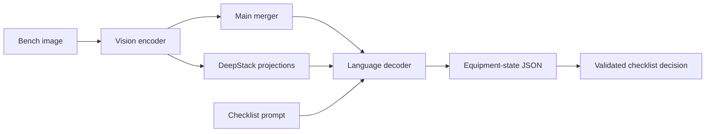

以英文版为准。

# 基于 Qwen3-VL 的实验室工作台器材完整性点检

计算机视觉课程作业 2 · 技术报告

## 摘要

该系统检查实验室工作台是否包含点检清单（checklist）所要求的设备。系统使用 Qwen3-VL-2B-Instruct 从单张俯视图像推断每个器材类别的状态。随后，确定性规则将这些状态转换为点检清单决策。我们研究带有配对监督（paired supervision）和器材框引导的图像编辑（box-guided image edits）的低秩适配（low-rank adaptation, LoRA），并评估两种部署优化：语言权重量化（language-weight quantization）与输入像素预算（input pixel budgets）。在 NVIDIA L40 服务器上的测量使用来自九个工作台摆放组的 50 张照片。在折外评测中，M 的误报齐全率为 2/31，B0 为 7/31。M 的 unknown 召回仍然偏低，为 1/18。在 Jetson Orin Nano 8GB 上，经哈希校验的最终 Q4_K_M bundle 在 384²–768² 三档上冷启动 1.68–2.53 s、稳态 1.21–1.29 s。对 50 张训练照片的部署检查复现了 77/100 决策和 2/31 误报齐全，与服务器一致。原始权重的 F16 在 8 GB 上放不下，最终 F16 文件未恢复、未测试。摄像头吞吐量和现场演示仍待完成。

## 1. 系统设计

用户选择所需设备，并提供已保存的照片或从相机界面请求一帧图像。支持的器材类别包括螺丝刀、钳子、独立盘绕的线缆束、万用表和锤子。万用表探针属于万用表，系统评分的是仪表是否存在，而不会读取其显示内容。

单一的视觉语言模型（vision-language model, VLM）通过同一接口接收图像和所请求的点检清单。这提供了一条从中文问题直接得到存在、缺席和未知状态的路径，包括决策取决于遮挡情况的情形。对于固定类别集合，带独立决策层的检测器是一种可行替代方案。本项目将其 VLM 流水线与自身的预训练基线进行比较。

模型返回一个 JSON 对象，其中每个类别对应一个状态。`present` 表示在检查区域内存在该物体的可见证据。`absent` 需要具备足够可见度以确认物体缺失。`unknown` 涵盖遮挡、取景和歧义。应用检查 JSON，并推导出缺失项和不确定项。必需项缺失会使决策为 `incomplete`。否则，任何必需的未知项都会使决策为 `unknown`。当所有必需项均存在时，决策为 `complete`。

图 1。 系统组合视觉特征与点检清单提示，然后验证并解释预测状态。

## 2. 模型原理

Qwen3-VL-2B-Instruct 将视觉 Transformer（vision transformer）与仅解码器语言模型（decoder-only language model）相结合。固定版本的模型配置使用 16×16 空间分块（spatial patches）、24 个视觉 Transformer 块和 2×2 空间合并器（spatial merger）。合并器将成组的视觉特征投影到语言模型的 2,048 维嵌入空间。语言解码器有 28 层，并使用分组查询注意力（grouped-query attention）。精确的模型修订版本为 `89644892e4d85e24eaac8bacfd4f463576704203`。[Qwen3-VL 技术报告](https://arxiv.org/abs/2511.21631) · [Qwen3-VL-2B-Instruct 模型卡](https://huggingface.co/Qwen/Qwen3-VL-2B-Instruct)

聊天模板（chat template）将图像 token 与文本置于同一输入序列中。主视觉投影为其提供输入嵌入。DeepStack 投影来自索引为 5、11 和 17 的中间视觉块的特征，并在早期语言层的图像 token 位置加入这些特征。交错式多模态旋转位置嵌入（interleaved multimodal rotary position embeddings）表示视觉 token 的空间位置和时间位置。推理期间，我们使用贪婪生成（greedy generation），新 token 上限为 128 个。[Qwen3-VL 技术报告](https://arxiv.org/abs/2511.21631) · [DeepStack 论文](https://arxiv.org/abs/2406.04334)

## 3. 领域自适应（domain adaptation）

低秩适配（low-rank adaptation, LoRA）训练形式为 $W'=W+(\alpha/r)BA$ 的更新，同时保持基础权重 $W$ 固定。我们的适配器在语言解码器的注意力和 MLP 投影上使用秩 16、缩放参数 32 和 dropout 0.05。视觉编码器和视觉合并器保持冻结。监督交叉熵基于助手响应 token 计算。输入提示 token 和图像 token 不计入损失。[LoRA 论文](https://arxiv.org/abs/2106.09685)

完整方法 M 组合了四种监督选择。配对存在性任务在具有不同真实标签（ground truth）的两个视角中，对同一类别提出相同问题。困难负样本（hard-negative examples）获得 3 的采样权重，以强调线缆—万用表混淆。状态均衡（state balancing）增加对稀有类别—状态组合的暴露。显式 `unknown` 示例教会模型在图像无法确定状态时表达不确定性。

器材框引导编辑从真实帧创建训练对。一帧在无设备区域接受一次编辑，并保留源标签。另一帧在一个物品上接受一次可比较的编辑，并将该物品状态改为 `absent`（用于移除）或 `unknown`（用于遮挡）。匹配编辑流程有助于减少对编辑本身是否存在这一线索的依赖。源布局 ID 在划分（splits）中随两张图像一同流转。

| 方法 | 训练数据 | 相对于 M 的变化 |
| --- | --- | --- |
| B0 | 预训练检查点（pretrained checkpoint） | 无任务特定训练 |
| B1 | 真实照片 | 采用均匀采样的普通点检清单 LoRA |
| M | 真实照片和器材框引导编辑 | 完整方法 |
| A1 | 真实照片和器材框引导编辑 | 移除配对存在性监督 |
| A2 | 真实照片和器材框引导编辑 | 将困难负样本权重设为 1 |
| A3 | 真实照片和器材框引导编辑 | 排除含 `unknown` 标签的样本 |
| A4 | 真实照片 | 沿用 M 的混合策略，仅使用真实数据 |

## 4. 数据集卡片（dataset card）

版本 `real_v1` 包含 50 张 1920×1080 的真实照片。这些照片在同一采集批次中使用固定俯视视角和自动曝光，在九个工作台摆放组上采集。每张图像有两个点检清单提示，共生成 100 个点检清单示例。全部 50 张真实图像均有已审核的物品状态标注和设备框。八个真实配对组包含恰好在一个目标类别上不同的视角。六张照片至少包含一个未知状态。真实评估包含 10 个遮挡点检清单示例，以及 6 个可见手部但未遮挡物品的示例。

版本 `aug/v1` 包含 50 个移除配对和 50 个遮挡配对，共 200 张编辑图像和 400 份点检清单。33 个在保留独立线缆的同时移除万用表的合成真编辑被标记为困难负样本。数据清单（data manifest）和划分清单记录输入及其哈希。合成编辑保留源场景组，且仅用于训练折。

| 折（fold） | 留出布局 | 真实训练示例 | 混合训练示例 | 真实测试照片 | 真实测试示例 |
| --- | --- | ---: | ---: | ---: | ---: |
| 1 | l009 | 50 | 250 | 25 | 50 |
| 2 | l008 | 66 | 330 | 17 | 34 |
| 3 | l001–l007 | 84 | 420 | 8 | 16 |

在每个折中，训练集和测试集的布局组互不重叠。每个真实示例恰好在一个测试折中出现一次。一张图像的两个提示，以及源自其布局的每个训练编辑，都随该布局进入相应划分。划分清单位于 [data/splits/cv3](../data/splits/cv3)。真实标签和编辑流程分别在 [data annotations](../data/annotations/README.md) 和 [EXPERIMENTS.md](../EXPERIMENTS.md) 中说明。

## 5. 部署

部署目标是 Jetson Orin Nano 8GB，即 NVIDIA 的 Jetson Orin Nano 系列中的一款模组。该设计通过 llama.cpp 和本地 Gradio 应用运行完整的视觉—语言流水线。语言权重，以及视觉编码器及其合并器，分别存储在独立的 GGUF 文件中。应用支持已保存图像和从相机捕获帧。Jetson 设备探测、运行时构建、基线检查、基准测试和 UI 启动均在[部署指南](../deploy/jetson/README.md)中说明。[NVIDIA Jetson 模组](https://developer.nvidia.com/embedded/jetson-modules)

部署用 adapter `M_final` 使用全量 500 条点检清单样本训练 50 步，数据包含 100 条真实样本和 400 条图像编辑样本。此次 L40 训练的 CUDA 峰值分配显存为 5.409 GiB。以同一条代表性样本验证，加载 adapter、在内存中合并以及重新加载合并模型后的贪心解码文本一致。记录的最大绝对 logit 差值为 2.3125。[训练清单](../runs/M_final/run_manifest.json) · [合并检查](../runs/M_final/merge_check.json)

各语言 GGUF 与共享视觉 GGUF 的文件大小如下。[导出清单](../runs/M_final/export_manifest.json)

| 文件 | 精度 | 大小 (bytes) | 大小 (GiB) |
| --- | --- | ---: | ---: |
| `final-f16.gguf` | F16 | 3,447,350,400 | 3.211 |
| `final-q8_0.gguf` | Q8_0 | 1,834,427,520 | 1.708 |
| `final-q4_k_m.gguf` | Q4_K_M | 1,107,410,048 | 1.031 |
| `mmproj-final-f16.gguf` | F16 | 819,394,784 | 0.763 |

部署包包含这些 GGUF、适配器、项目源码快照、llama.cpp 源码和部署说明。清单中的全部 91 个文件均通过了 SHA256 校验。Q4_K_M 和 Q8_0 均使用训练照片在 L40 上各运行了 100 次点检清单请求，每种精度均获得 100 个已解析响应。这些请求验证了导出格式与推理兼容性。留出折实验提供了任务质量证据。部署包：服务器上为 91 文件完整包，板端为 86 文件 Q4-only 副本。[部署包校验和](../runs/M_final/bundle_SHA256SUMS) · [导出验证](../runs/M_final/gguf_smoke_check.json)

2026-11-26 将服务器最终 bundle 恢复到板上，并逐字节对照 `runs/M_final/bundle_SHA256SUMS`。最终 Q4_K_M 语言权重（1,107,410,048 B，SHA256 `ebbb2b33…a52cbc`）、F16 mmproj（`96671dad…0174d3`）和 LoRA 适配器（`db07fc40…e4368a`）全部匹配。板端用 Q4_K_M 在 384²/512²/768² 跑最终 M，并在 512² 评测全部 50 张真实照片（100 条 checklist）。最终 Q8_0 与 F16 GGUF 未恢复；F16 在原始权重下已放不进 8 GB。板上使用固定 b12425 CUDA sm_87 构建。

| Jetson Orin Nano 8GB 证据 | 结果 |
| --- | --- |
| 构建与图像推理 | 通过：b12425 CUDA sm_87；最终 Q4_K_M 512² 在 v001 上冷启动端到端 3.83 s，输出可解析 |
| 按精度和像素预算评估的任务质量 | 50 张训练照片（100 条）的部署检查，Q4_K_M 512²：决策 77/100、误报齐全 2/31、unknown 召回 16/18、三状态准确率 446/500、JSON 有效 100/100。这些照片参与过最终训练，不是泛化指标。折外结果仍为 86/100、2/31、1/18。 |
| 端到端延迟 p50/p95 与首 token 计时 | 最终 Q4_K_M 冒烟基准：384²/512²/768² 冷启动 p50/p95 为 1.68/2.12、1.86/2.29、2.53/2.80 s（n=3）；稳态 p50/p95 为 1.21/1.24、1.25/1.28、1.29/1.33 s。真实照片 512²：p50/p95 3.01/3.39 s，prefill p50 0.40 s，生成 p50 1.11 s。 |
| Requests/s、生成 token/s 和相机显示 FPS | 真实照片 512²：0.335 request/s 与 36.3 token/s。最终 Q4 冒烟基准：三档 38.9/38.2/37.9 token/s。相机 FPS 未测（无摄像头设备）。 |
| 峰值共享内存和功耗 | 最终 Q4 冒烟基准：RAM 7.22–7.31 GB、VDD_IN 19.3–19.9 W。真实照片评测：RAM 7.32/7.43 GB，VDD_IN 均值/峰值 12.1/18.9 W。包含桌面与 agent 会话；swap 已用量也包含之前的基准状态。 |
| 相机演示和视频 | 待完成：没有 `/dev/video*`。Gradio 已保存图片模式在 v001/v014/v040/v041 上的决策与 L40 一致（unknown/incomplete/complete/unknown）；板端推理 3.16–3.57 s。 |

板端最终数字是部署测量。冒烟基准只用三张合成图做计时与资源；100 次正式请求重复这三张图，会命中 llama-server 的 prompt cache，prefill 约 0.03 s，稳态时间主要由生成决定。真实照片指标使用参与最终训练的 1920×1080 照片，验证导出与板端部署，不是泛化结果。每档内存与功耗包含板子的桌面与 agent 进程，因为 8 GB 与操作系统共享；swap 数值在两次运行之间没有重置。最终 Q8_0 与 F16 文件未恢复；F16 的 out-of-memory 结论来自原始权重。摄像头吞吐量仍未测量。2026-11-25 的原始权重 Q4/Q8 测量保留在 `runs/jetson/board_20261125/` 作为设备参考。

## 6. 优化

输入分辨率实验使用三个像素预算：384²、512² 和 768²，并保持宽高比。对 16×16 分块进行 2×2 合并，相当于语言侧每个视觉 token 对应一个 32×32 空间区域。降低预算会减少视觉 token 数量，以及视觉编码和预填充（prefilling）的成本。它也可能使狭窄的螺丝刀手柄、线缆和部分被遮挡的物体变得模糊。

量化实验将像素预算固定为 512²，并在 F16、Q8_0 和 Q4_K_M 之间改变 GGUF 语言权重精度。Q8_0 使用分块式 8 位量化（block-wise 8-bit quantization）。Q4_K_M 使用混合量化类型，平均位宽更低，且选定张量以更高精度存储。mmproj 文件始终保持 F16。体积缩减会影响存储和权重传输，运行时内存还包括激活、暂存空间和 KV 缓存。[固定版本的 llama.cpp 源码](https://github.com/ggml-org/llama.cpp/tree/b12425)

## 7. 实验评估

### 7.1 协议与指标

所有已训练方法都使用 50 个更新步（update steps）、有效批量大小 16、随机种子（seed）42 和 BF16，学习率为 0.0001，像素预算为 512²。因此，每次运行共送入 800 个训练样本，并按各方法的规定进行重复或重新加权。学习率调度和适配器超参数保持不变。B0 直接在真实测试套件上评估。对于每个已训练方法，三个测试折分别由各自的适配器预测，并在评分前聚合。这些步数根据仅使用训练数据的试点损失确定。没有使用任何折的测试示例来调优其适配器。

决策准确率（decision accuracy）是与真实标签匹配的点检清单决策所占比例。误报齐全率（false-complete rate）是真正为 `incomplete` 的案例中预测为 `complete` 的数量，除以真正为 `incomplete` 的案例数量。unknown 召回率（unknown recall）是真实未知物品状态中被预测为未知的比例。评估还计算三态准确率（three-state accuracy）和宏平均 F1（macro F1）、缺失项集合 F1（missing-item set F1）以及输出有效性（output validity）。无效回答仍保留在评分分母中。95% 百分位区间（percentile intervals）使用按场景组聚类的 1,000 次重采样自助法（bootstrap）。现有九个摆放组，低于评估设定的最低十组，因此区间标为样本不足。

### 7.2 真实图像模型比较与消融

| 方法 | 决策准确率 | 误报齐全率 | unknown 召回率 | 状态准确率 | 宏平均 F1 | 缺失项集合 F1 |
| --- | --- | --- | --- | --- | --- | --- |
| [B0](../runs/B0_s001/eval/metrics.json) | 80/100 | 7/31 | 2/18 | 444/500 | 0.618 | 0.771 (54/70) |
| [B1](../runs/B1_cv3/eval/metrics.json) | 87/100 | 2/31 | 0/18 | 473/500 | 0.629 | 0.892 (66/74) |
| [M](../runs/M_cv3/eval/metrics.json) | 86/100 | 2/31 | 1/18 | 468/500 | 0.638 | 0.861 (62/72) |
| [A1](../runs/A1_cv3/eval/metrics.json) | 88/100 | 2/31 | 1/18 | 475/500 | 0.662 | 0.907 (68/75) |
| [A2](../runs/A2_cv3/eval/metrics.json) | 87/100 | 2/31 | 2/18 | 472/500 | 0.670 | 0.877 (64/73) |
| [A3](../runs/A3_cv3/eval/metrics.json) | 91/100 | 2/31 | 0/18 | 480/500 | 0.636 | 0.907 (68/75) |
| [A4](../runs/A4_cv3/eval/metrics.json) | 87/100 | 2/31 | 0/18 | 472/500 | 0.624 | 0.877 (64/73) |

B1 和 M 分别比 B0 少产生 5 次误报齐全决策。B1 的决策准确率为 87/100，M 为 86/100，而 B0 为 80/100。两项决策准确率差值的配对布局自助法区间均包含 0，且摆放组数量不足。unknown 召回率仍然很低。[完整比较](../runs/comparison/comparison.md) · [配对审计](../runs/comparison/cv_case_review.txt)

在混合协议保持固定的情况下，M 和 A4 都产生了 2 次误报齐全决策。M 少了一个正确决策，并多恢复了一个未知物品状态。在可用布局下，准确率差异在统计上无法得出结论。实验未证明编辑训练图像带来了总体准确率收益。

相对于 M，A1 移除配对辅助任务，A2 降低困难负样本权重，使正确决策数分别变化了 2 个和 1 个。两项差异的配对区间均包含 0。A3 移除未知监督后产生了 91/100 的正确决策和 0/18 的unknown 召回率。这是在可用布局上观察到的一项权衡。所有 LoRA 变体的误报齐全次数均为 2/31。

我们检查了 B0 审计中识别出的四张存在线缆—万用表混淆的照片。M 在每张照片的两个提示中都将该仪表识别为缺失。B1 在其中第一张照片的一个提示中返回了 unknown。B0 曾把可见或缺失的螺丝刀称为 unknown 的重复错误，在微调后出现得较少。真实遮挡仍然使大多数未知状态未被检出。[样本审计](../runs/comparison/cv_case_review.txt)

部署规则保留了 M，因为没有比较方法在至少保持相同决策准确率的同时实现严格更低的误报齐全率。该决策是预先声明的项目规则。实验使用六个采用微调适配器的评估以及原始基线，全部覆盖同样的 100 份点检清单。

### 7.3 鲁棒性

我们创建了一个名为 `clean` 的 JPEG 质量 95 对照条件，以及真实照片的八种确定性模拟干扰。所用变换包括：变暗使用 0.5 和 0.3 的亮度系数，增亮使用 1.5 和 2.0 的亮度系数；高斯模糊的 σ 为 2 和 4 像素；高斯噪声的 σ 为 15 和 30 个强度级。对严重变体的目视复核支持保留原始标签。每个条件都包含相同的 100 份点检清单和九个摆放组。B1 和 M 使用每张照片所属留出折的适配器。[数据清单](../runs/robust/dataset_manifest.json)

图 2。在共享 JPEG 处理流水线及各严重模拟干扰下选取的照片。这些条件均为由真实照片生成的模拟条件。

括号中的数字表示相对于同一模型 `clean` 结果的百分点变化。所有预测均使用相同标签集和评分流程进行评分。

| 条件 | 方法 | 决策准确率 | 误报齐全率 | unknown 召回率 |
| --- | --- | ---: | ---: | ---: |
| clean | B0 | 80/100 | 7/31 | 2/18 |
| clean | B1 | 86/100 | 2/31 | 0/18 |
| clean | M | 87/100 | 2/31 | 3/18 |
| dark_l1 | B0 | 81/100 (+1.0 pp) | 7/31 (+0.0 pp) | 1/18 (-5.6 pp) |
| dark_l1 | B1 | 85/100 (-1.0 pp) | 1/31 (-3.2 pp) | 0/18 (+0.0 pp) |
| dark_l1 | M | 87/100 (+0.0 pp) | 0/31 (-6.5 pp) | 2/18 (-5.6 pp) |
| dark_l2 | B0 | 84/100 (+4.0 pp) | 5/31 (-6.5 pp) | 3/18 (+5.6 pp) |
| dark_l2 | B1 | 80/100 (-6.0 pp) | 0/31 (-6.5 pp) | 0/18 (+0.0 pp) |
| dark_l2 | M | 79/100 (-8.0 pp) | 0/31 (-6.5 pp) | 2/18 (-5.6 pp) |
| bright_l1 | B0 | 82/100 (+2.0 pp) | 7/31 (+0.0 pp) | 2/18 (+0.0 pp) |
| bright_l1 | B1 | 84/100 (-2.0 pp) | 2/31 (+0.0 pp) | 0/18 (+0.0 pp) |
| bright_l1 | M | 85/100 (-2.0 pp) | 1/31 (-3.2 pp) | 2/18 (-5.6 pp) |
| bright_l2 | B0 | 81/100 (+1.0 pp) | 7/31 (+0.0 pp) | 2/18 (+0.0 pp) |
| bright_l2 | B1 | 86/100 (+0.0 pp) | 1/31 (-3.2 pp) | 0/18 (+0.0 pp) |
| bright_l2 | M | 82/100 (-5.0 pp) | 0/31 (-6.5 pp) | 0/18 (-16.7 pp) |
| blur_l1 | B0 | 80/100 (+0.0 pp) | 6/31 (-3.2 pp) | 3/18 (+5.6 pp) |
| blur_l1 | B1 | 85/100 (-1.0 pp) | 0/31 (-6.5 pp) | 0/18 (+0.0 pp) |
| blur_l1 | M | 86/100 (-1.0 pp) | 0/31 (-6.5 pp) | 3/18 (+0.0 pp) |
| blur_l2 | B0 | 80/100 (+0.0 pp) | 5/31 (-6.5 pp) | 3/18 (+5.6 pp) |
| blur_l2 | B1 | 80/100 (-6.0 pp) | 0/31 (-6.5 pp) | 0/18 (+0.0 pp) |
| blur_l2 | M | 78/100 (-9.0 pp) | 0/31 (-6.5 pp) | 2/18 (-5.6 pp) |
| noise_l1 | B0 | 84/100 (+4.0 pp) | 7/31 (+0.0 pp) | 5/18 (+16.7 pp) |
| noise_l1 | B1 | 83/100 (-3.0 pp) | 1/31 (-3.2 pp) | 0/18 (+0.0 pp) |
| noise_l1 | M | 81/100 (-6.0 pp) | 0/31 (-6.5 pp) | 1/18 (-11.1 pp) |
| noise_l2 | B0 | 84/100 (+4.0 pp) | 5/31 (-6.5 pp) | 0/18 (-11.1 pp) |
| noise_l2 | B1 | 86/100 (+0.0 pp) | 0/31 (-6.5 pp) | 0/18 (+0.0 pp) |
| noise_l2 | M | 83/100 (-4.0 pp) | 0/31 (-6.5 pp) | 2/18 (-5.6 pp) |

M 相对于 `clean` 的最大决策准确率降幅，是在严重模糊下少了 9 个正确决策，在严重变暗下少了 8 个。两个条件均记录为 0/31 次误报齐全决策。严重增亮使 M 的unknown 召回率从 3/18 降至 0/18。基线在这些模拟干扰下的决策准确率没有下降。结果表明，在该采集批次中，模型对特定模拟条件具有敏感性。

下表使用原始照片上记录的条件标签。遮挡和可见手部子集各代表一个摆放组。带有零分母的破折号表示指标未定义。

| 记录条件 | 方法 | 点检清单 | 摆放组 | 决策准确率 | 误报齐全率 | unknown 召回率 |
| --- | --- | ---: | ---: | ---: | ---: | ---: |
| occlusion | B0 | 10 | 1 | 4/10 | — (0) | 0/14 |
| occlusion | B1 | 10 | 1 | 4/10 | — (0) | 0/14 |
| occlusion | M | 10 | 1 | 4/10 | — (0) | 1/14 |
| hand_no_occlusion | B0 | 6 | 1 | 4/6 | — (0) | — (0) |
| hand_no_occlusion | B1 | 6 | 1 | 6/6 | — (0) | — (0) |
| hand_no_occlusion | M | 6 | 1 | 6/6 | — (0) | — (0) |

### 7.4 服务器优化结果与性能

两项比较都在 NVIDIA L40 服务器上使用同样的 100 个真实点检清单示例。像素预算扫描使用采用 BF16 的 Transformers。精度扫描使用相同的 llama.cpp 配置和 512² 图像预算。端到端延迟衡量单次请求的耗时。请求吞吐量为 batch 为 1 的请求数除以这些请求的端到端耗时之和。对于每种配置，结果均包含全部 100 个已记录请求。后端对首 token 计时（first-token timing）的解释不同，因此不适合在两组扫描之间直接比较该指标。

| 后端与精度 | 像素 | 决策准确率 | 误报齐全率 | unknown 召回率 | 螺丝刀状态准确率 | 延迟 p50 / p95 (s) | Requests/s |
| --- | --- | --- | --- | --- | --- | --- | --- |
| [Transformers BF16](../runs/B0_s001_r384/eval/metrics.json) | 384² | 81/100 | 7/31 | 1/18 | 63/100 | 1.377 / 1.433 | 0.719 |
| [Transformers BF16](../runs/B0_s001/eval/metrics.json) | 512² | 80/100 | 7/31 | 2/18 | 67/100 | 1.387 / 1.444 | 0.714 |
| [Transformers BF16](../runs/B0_s001_r768/eval/metrics.json) | 768² | 85/100 | 6/31 | 1/18 | 91/100 | 1.411 / 1.584 | 0.696 |
| [llama.cpp F16](../runs/B0_s001_f16/eval/metrics.json) | 512² | 80/100 | 7/31 | 2/18 | 66/100 | 1.382 / 1.507 | 0.722 |
| [llama.cpp Q8_0](../runs/B0_s001_q8/eval/metrics.json) | 512² | 80/100 | 7/31 | 3/18 | 66/100 | 1.269 / 1.382 | 0.787 |
| [llama.cpp Q4_K_M](../runs/B0_s001_q4/eval/metrics.json) | 512² | 73/100 | 7/31 | 7/18 | 76/100 | 1.211 / 1.360 | 0.818 |

将 BF16 像素预算从 384² 提高到 768²，使螺丝刀状态准确率从 63/100 提高到 91/100。误报齐全次数在 384² 和 512² 时为 7/31，在 768² 时为 6/31，而 768² 下的请求延迟更高。该差异是描述性的，因为它基于九种布局。

在 512² 的 llama.cpp 比较中，Q8_0 在此数据集上保持了 F16 的决策准确率。Q4_K_M 的观测 p50 延迟最低，并且比 F16 少了 7 个正确决策。三种配置都在 31 个不完整案例中产生了 7 次误报齐全决策。Q4_K_M 检出了 18 个未知物品状态中的 7 个，而 F16 检出了同样的 18 个状态中的 2 个。这些测量描述的是服务器上的 B0 GGUF 配置。

### 7.5 服务器图像模式演示

我们在 NVIDIA L40 上使用最终的 Q4_K_M 语言文件、F16 mmproj 和 512² 像素预算运行 Gradio 应用。在已保存图像模式下请求了全部五个器材类别。前三个案例分别测试完整工作台、线缆可见但万用表缺失，以及遮挡。由于第一张图像的线缆被返回为 unknown，我们增加了一个线缆更清晰的完整工作台作为第四个案例，并保留了两项结果。所有请求均使用包含在最终训练中的照片。[图像模式验证](../runs/M_final/demo/image_mode_check.json)

| 照片 | 真实决策 | 系统决策 | 观察 | L40 请求耗时 (s) |
| --- | --- | --- | --- | ---: |
| `v001` | `complete` | `unknown` | 线缆被判为 unknown。 | 1.267 |
| `v014` | `incomplete` | `incomplete` | 线缆束存在，万用表缺失。 | 1.183 |
| `v041` | `unknown` | `unknown` | 螺丝刀和线缆均被判为 unknown。 | 1.189 |
| `v040` | `complete` | `complete` | 全部五个类别均存在。 | 1.214 |

第二个案例正确判断仅缺万用表。遮挡案例的点检结论为 unknown，符合预期。遮挡图中的可见线缆以及第一张齐全图中的线缆，均被多判为 `unknown`。第四个案例判为 complete。记录的耗时均来自单次服务器请求。

图 3。带细线缆的齐全场景。

图 4。独立线缆仍存在，万用表缺失。

图 5。螺丝刀被手遮挡。

图 6。补测的齐全场景，线缆更清晰。

## 8. 局限性与未来工作

数据集来自一个采集批次与九个摆放组，各折规模分别为 25、17 和 8 张照片。每张照片的两个提示相互关联。按摆放组的 bootstrap捕捉了布局内依赖关系，但少数大型布局可能主导估计结果。评估未证明系统可跨实验室、独立采集会话或光照条件泛化。未来验证集应采集具有不同曝光的独立会话，并为每个物品状态提供可比较的表示。

图像修复（inpainting）区域和合成遮挡物具有可识别的纹理。真实条件下的分母较小，而模拟的亮度、模糊和噪声只检验图像级变化。后续数据可覆盖自然反射、自动曝光过渡和真实手部遮挡。对于低置信度图像，操作员可请求第二个视角进行确认。基准报告点检清单决策。成对一致性（pair consistency）的实现要求每对只含两条记录。真实数据的成对照片各有两条问法，每对共四条，因此本测试集的成对一致性汇总指标无定义。

Jetson 构建现已验证：llama.cpp b12425 能为 sm_87 编译，最终 Q4_K_M bundle 与服务器哈希一致，板端在 96/100 个样本上复现服务器决策（91/100 个器材状态）。板端真实照片指标是训练集上的部署检查，不是泛化结果；折外评测仍是任务质量证据。最终 Q8_0 与 F16 文件未恢复，F16 在原始权重下放不进 8 GB。冒烟基准重复三张图并命中 prompt cache，不能替代真实照片 3.01 s 的中位数。捕获速率与摄像头吞吐量仍未测量。

## 9. 结论

在真实折外评测中，M 的误报齐全率为 2/31，决策准确率为 86/100。B0 的对应结果为 7/31 与 80/100。摆放组数量较少限制了决策准确率比较的强度。unknown 召回率仍然偏低，而模拟干扰中的严重变暗和模糊暴露了 M 的敏感性。

L40 实验确立了服务器侧在输入分辨率和语言量化方面的权衡。最终 GGUF 和应用已通过服务器侧检查。在 Jetson Orin Nano 8GB 上，经哈希校验的最终 Q4_K_M bundle 稳态 1.21–1.29 s、真实照片中位数 3.01 s，演示决策与服务器一致。训练照片部署检查复现 77/100 决策和 2/31 误报齐全；折外结果仍为 86/100 与 2/31。原始权重的 F16 放不进 8 GB（最终 F16 文件未恢复），摄像头吞吐量和现场演示仍待完成。
